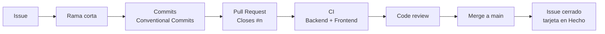

# Huellitas 🐾

Aplicación web para que un refugio pequeño gestione las fichas de sus mascotas en adopción.


## Contexto

Proyecto del **Primer Parcial de Programación Móvil** de la **Universidad Técnica de Machala**. Más que la complejidad técnica, su objetivo es demostrar un flujo moderno de desarrollo:

- **Spec Driven Development (SDD)** con [GitHub Spec Kit](https://github.com/github/spec-kit).
- Trabajo en **ramas** y **Pull Requests** con revisión cruzada.
- Integración continua con **GitHub Actions**.
- Gestión con **Issues**, **Projects** y **Milestones**.

## Funcionalidades

- **Registrar** una mascota (nombre, especie, edad, estado y descripción opcional), con validación en el formulario y en la API.
- **Listar** las mascotas en tarjetas, de la más reciente a la más antigua, con **filtros** por especie (perro, gato, otro) y estado (disponible, adoptado).
- **Ver la ficha** de detalle de una mascota.
- **Editar** una mascota (incluido volver de "adoptado" a "disponible").
- **Marcar como adoptada** desde el detalle.
- **Eliminar** una mascota con un diálogo de confirmación propio.
- **Resumen** en la página de inicio con el número de mascotas disponibles y adoptadas.
- Diseño adaptable pensado primero para celular.

## Stack tecnológico

| Capa | Tecnología |
|------|------------|
| Frontend | Angular 22 (componentes standalone), TypeScript estricto, Tailwind CSS 4 |
| Backend | Node.js 24, Express 5, Mongoose 9 |
| Base de datos | MongoDB Atlas (colección única `mascotas`) |
| Pruebas | `node --test` (backend), Vitest con `ng test` (frontend) |
| CI | GitHub Actions |
| Especificación | GitHub Spec Kit |

## Estructura del repositorio

```text
huellitas/
├── .github/workflows/      # Pipeline de CI (ci.yml)
├── .specify/memory/        # Constitución del proyecto (Spec Kit)
├── specs/001-fichas-mascotas/  # Especificación, plan, tareas y contratos de la funcionalidad
├── backend/                # API REST con Express + Mongoose
│   ├── src/                # app, servidor, modelo, rutas y utilidades de validación
│   └── test/               # Pruebas unitarias con node --test
└── frontend/               # Aplicación Angular + Tailwind
    └── src/app/            # Páginas (inicio, lista, detalle, formulario), servicios y componentes
```

## Cómo ejecutarlo localmente

### Requisitos

- **Node.js 24** y npm.
- Una base de datos MongoDB (por ejemplo, un clúster de MongoDB Atlas).

### Backend

```bash
cd backend
cp .env.example .env      # luego completa MONGODB_URI con tu cadena de conexión
npm install
npm run dev               # API en http://localhost:3000
```

Variables de `backend/.env`:

| Variable | Descripción |
|----------|-------------|
| `MONGODB_URI` | Cadena de conexión a MongoDB (**obligatoria**; nunca se sube al repositorio) |
| `PORT` | Puerto de la API (por defecto `3000`) |
| `CORS_ORIGIN` | Origen permitido del frontend (por defecto `http://localhost:4200`) |
| `DNS_SERVERS` | Opcional: servidores DNS si falla la consulta SRV de Atlas |

### Frontend

```bash
cd frontend
npm install
npm start                 # abre http://localhost:4200
```

### Pruebas

```bash
# Backend
cd backend
npm test                  # node --test

# Frontend
cd frontend
npm test                  # modo interactivo
npm run test:ci           # una sola ejecución (como en CI)
```

## Endpoints de la API

Base: `http://localhost:3000/api`

| Método | Ruta | Descripción |
|--------|------|-------------|
| `GET` | `/salud` | Verifica que la API esté en funcionamiento |
| `GET` | `/mascotas` | Lista las mascotas; filtros opcionales `?especie=` y `?estado=` |
| `GET` | `/mascotas/resumen` | Cuenta las mascotas disponibles y adoptadas |
| `GET` | `/mascotas/:id` | Obtiene una mascota por su ID |
| `POST` | `/mascotas` | Crea una mascota |
| `PUT` | `/mascotas/:id` | Actualiza una mascota |
| `DELETE` | `/mascotas/:id` | Elimina una mascota |

El contrato completo está en [contracts/api-mascotas.md](specs/001-fichas-mascotas/contracts/api-mascotas.md).

## Flujo de trabajo



**Trunk Based simplificado:** `main` es la única rama de larga duración y está protegida. Cada Issue se trabaja en una rama corta que se integra a `main` mediante un Pull Request.

**Convención de ramas:**

| Prefijo | Uso |
|---------|-----|
| `docs/` | Documentación y artefactos de especificación |
| `ci/` | Pipeline de GitHub Actions |
| `test/` | Pruebas unitarias |
| `feature/` | Funcionalidades del backend o frontend |

**Reglas de `main`:**

- Pull Request obligatorio con **1 aprobación**.
- Checks obligatorios: **Backend (tests)** y **Frontend (build + tests)**.
- Sin force push ni borrado de la rama.

## Desarrollo guiado por especificaciones

Toda la funcionalidad se definió con Spec Kit antes de escribir código:

| Artefacto | Archivo | Propósito |
|-----------|---------|-----------|
| Constitución | [constitution.md](.specify/memory/constitution.md) | Principios, stack y reglas del proyecto |
| Especificación | [spec.md](specs/001-fichas-mascotas/spec.md) | Historias de usuario, requisitos y criterios de éxito |
| Clarificaciones | [spec.md § Aclaraciones](specs/001-fichas-mascotas/spec.md#aclaraciones) | Dudas resueltas e incorporadas a la especificación |
| Plan | [plan.md](specs/001-fichas-mascotas/plan.md) | Diseño técnico, con [research](specs/001-fichas-mascotas/research.md), [modelo de datos](specs/001-fichas-mascotas/data-model.md), [contrato de API](specs/001-fichas-mascotas/contracts/api-mascotas.md) y [quickstart](specs/001-fichas-mascotas/quickstart.md) |
| Tareas | [tasks.md](specs/001-fichas-mascotas/tasks.md) | Lista ordenada de tareas de implementación |
| Análisis | `/speckit-analyze` | Revisión de consistencia entre spec, plan y tasks (solo lectura, no genera archivo); complementada por el [checklist de requisitos](specs/001-fichas-mascotas/checklists/requirements.md) |

## Calidad

- **Backend:** pruebas unitarias con `node --test` de las utilidades de validación (`validarMascota`, `validarFiltros`) y del conteo por estado (`contarPorEstado`), escritas con **TDD**: el ciclo rojo → verde es visible en los commits del PR de pruebas.
- **Frontend:** pruebas con Vitest (`ng test`) del servicio de mascotas, validadores, formulario, detalle, diálogo de confirmación y notificaciones.
- Ambas suites se ejecutan en **GitHub Actions** en cada Pull Request y push a `main`; el frontend además debe compilar.

## Equipo

| Integrante | Responsabilidades |
|------------|-------------------|
| Melissa Jarley Campos Rogel ([@melissacam](https://github.com/melissacam)) | Especificación SDD con Spec Kit, frontend Angular + Tailwind, documentación |
| Andy Aguirre Paladines Guilver ([@Andyx1923](https://github.com/Andyx1923)) | API REST con Express y MongoDB Atlas, pipeline de GitHub Actions, pruebas unitarias con TDD |

## Docente

**Ing. Joffre Jeorwin Cartuche Calva, Mgs.**<br>
Carrera de Ingeniería en Tecnologías de la Información · Facultad de Ingeniería Civil · Octavo semestre, paralelo A.
